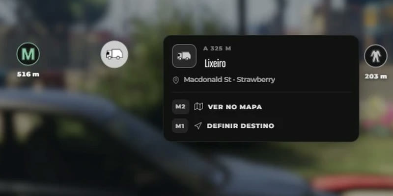
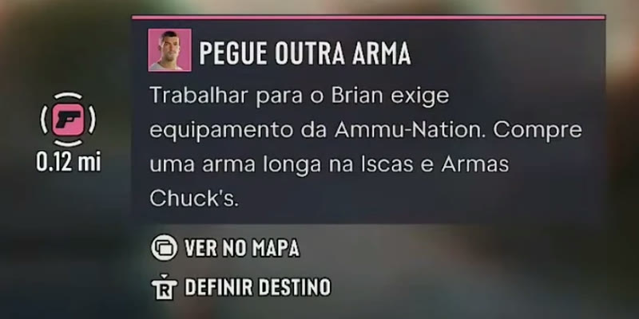

# mengazo-horizon

[Português](README.md) · **English**

Map markers projected onto the horizon. The player holds a key (default `J`), the game blurs and nearby blips appear in the real direction they are in. Aiming at a marker opens a card with its name, location and distance, and the player can set it as the waypoint (left click) or open the map on it (right click).

Made by [Mengazo](https://tebex.mengazo.com/?utm_source=github&utm_medium=free-script&utm_campaign=horizon). Free and open source.

## Compared with GTA VI

<table>
  <tr>
    <td width="50%"></td>
    <td width="50%"></td>
  </tr>
  <tr>
    <td align="center"><b>mengazo-horizon</b> in FiveM</td>
    <td align="center"><b>GTA VI</b> (image: Rockstar Games)</td>
  </tr>
</table>

Both screenshots use the Portuguese interface.

## Installation

1. Add `ensure mengazo-horizon` to your `resources.cfg`.
2. The interface ships prebuilt in `web/build`. To change it, run `npm ci --prefer-offline` and `npm run build` inside `web/`.

## Language

The texts are in English by default. Set `LANGUAGE = 'pt-BR'` in `config/config.lua` for Brazilian Portuguese, or edit the texts in `config/lang.lua`.

## Where markers come from

| Source | How |
| --- | --- |
| Map blips | Read automatically (`SCAN_GAME_BLIPS`), with no setup: the blip's real name, the blip's color and the street/district of its position |
| Optional per-blip tweaks | `exports['mengazo-horizon']:setBlipDetails(blip, { label, description, icon, color, image, priority, hidden })` |
| Point without a blip (client) | `exports['mengazo-horizon']:registerPoint(id, { coords, label, description, icon, color, image, priority })` |
| Per-player point (server) | `exports['mengazo-horizon']:setPlayerPoint(source, id, data)` and `removePlayerPoint(source, id)` |
| Fixed points | `CUSTOM_POINTS` in the config |

A higher `priority` is shown ahead of the others (a mission objective, for example). `image` is the avatar shown on the card.

## How the blip's real name is captured

The game has no native that returns a blip's name as text, but it does have `AddTextComponentSubstringBlipName(blip)`, which injects that name into text drawn by the game itself. That is why the title on a blip's card is drawn by the game (font `TITLE_FONT`) inside a window cut out of the interface card; the rest of the card is NUI.

Name order: `label` from `setBlipDetails` → the blip's real name → the game's default name for the sprite (`BLIP_<sprite>`) → `DEFAULT_LABEL` (in `config/lang.lua`, or in `config/config.lua` to override it).

If the text is vertically misaligned, adjust `TITLE_OFFSET_Y`.

## Exports (client)

`registerPoint`, `removePoint`, `setBlipDetails`, `clearBlipDetails`, `openHorizon`, `closeHorizon`, `isHorizonActive`

## Events (client)

| Event | Parameters |
| --- | --- |
| `mengazo-horizon:opened` | |
| `mengazo-horizon:closed` | |
| `mengazo-horizon:destinationChanged` | `pointId` (nil when removed), `coords` |
| `mengazo-horizon:viewedOnMap` | `pointId`, `coords` |

## Example: custom description and icon on a blip

```lua
local blip = AddBlipForCoord(x, y, z)

exports['mengazo-horizon']:setBlipDetails(blip, { description = 'Open 24 hours.', icon = 'medical' })
```

## Available icons

`pin`, `store`, `weapon`, `car`, `garage`, `medical`, `police`, `money`, `home`, `star`, `flag`, `tool`, `user`, `work`

These icons apply to registered points and to sprites without an image. Map blips use the sprite's real artwork, tinted with the blip's color (`USE_BLIP_IMAGES`). The images live in `web/public/blips/<sprite>.png` and come from the blip reference on docs.fivem.net; to add a new sprite, put the file there, add its id to `web/src/lib/blipSprites.ts` and run the build.

## Configuration

Every option is in `config/config.lua`, with a comment next to each key.

## More from Mengazo

Horizon is free. If it helps your server, take a look at the paid scripts, built with the same care and supporting ESX, QBCore and Qbox:

- **[Mengazo Survival](https://tebex.mengazo.com/scripts/survival?utm_source=github&utm_medium=free-script&utm_campaign=horizon)**: a full death system, from the shot to the respawn. Every death has a replay, and reports reach staff with the clip attached.
- **[Mengazo Police](https://tebex.mengazo.com/scripts/police?utm_source=github&utm_medium=free-script&utm_campaign=horizon)**: tablet, criminal records, incident reports, penal code, arrests, live dispatch and body cam in a single system.

Store: **[tebex.mengazo.com](https://tebex.mengazo.com/?utm_source=github&utm_medium=free-script&utm_campaign=horizon)** · Support and news: **[Discord](https://dsc.gg/mengazo)**

## License

Code under the MIT license (see `LICENSE`). The images in `web/public/blips` are GTA V blip icons, owned by Rockstar Games, taken from the blip reference on docs.fivem.net, and are not covered by the MIT license.
